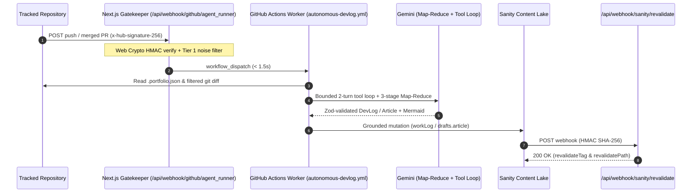

# BENJINEER Portfolio & Autonomous Agentic Technical Writer

<div align="center">
    <a href="https://youtu.be/jg4Dp8fIFwE" target="_blank" rel="noopener noreferrer">
        
    </a>
</div>

A headless CMS portfolio and engineering blog platform built with **Next.js (App Router + On-Demand ISR)**, **TypeScript**, and **Sanity CMS**, powered by an **Autonomous Agentic Technical Writer** that turns real GitHub repository activity into schema-grounded DevLogs, milestone articles, and architecture diagrams.

**Core Stack:** Next.js 16 • React 19 • TypeScript • Tailwind CSS v4 • Sanity CMS • Google Gemini • GitHub Actions • Playwright • Mermaid • Shiki • Resend • Google reCAPTCHA v3

---

## 1. Executive Summary & Core Capabilities

### 1.1 Headless Portfolio & Engineering Reading Experience
- **Route Encapsulation:** Public portfolio routes (`/`, `/projects`, `/project/[slug]`, `/blog`, `/blog/[slug]`, `/blog/[slug]/article`) live inside the `(portfolio)` route group with a persistent `AppShell`, isolating the embedded `/studio` Sanity workspace into an unconstrained full-screen editorial view.
- **Technical Content Rendering:** Rich Portable Text and Markdown rendering featuring IDE-style **Shiki** syntax-highlighted code blocks, responsive **Mermaid** architecture diagrams, 16:9 ambient-backdrop media framing, and a split-view Lightbox modal synced with `?media=` and `?play=` URL state.
- **Instant Cache Freshness:** Tag-based on-demand Next.js ISR revalidation triggered by Sanity webhooks (`/api/webhook/sanity/revalidate`).

### 1.2 Autonomous Agentic Technical Writer
- **Event-Driven Synthesis:** Listens to `push` and merged `pull_request` events from tracked repositories via a sub-second serverless gatekeeper and dispatches an ephemeral GitHub Actions worker (`autonomous-devlog.yml`).
- **Schema-Grounded & Self-Healing:** Uses a 3-Stage Map-Reduce pipeline paired with a bounded 2-turn autonomous tool loop, Zod + Gemini `responseSchema` self-healing validation, Playwright live screenshot capture, and deterministic Mermaid syntax verification before publishing to Sanity.

---

## 2. System Architecture Blueprint

### 2.1 End-to-End Event & Publishing Pipeline



### 2.2 Codebase Layout & Routing Topology

```text
├── src/
│   ├── app/
│   │   ├── (portfolio)/                  # Public views wrapped by <AppShell>
│   │   ├── studio/[[...tool]]/           # Full-screen embedded Sanity Studio
│   │   └── api/
│   │       ├── contact/                  # reCAPTCHA v3 + Resend contact endpoint
│   │       └── webhook/
│   │           ├── github/agent_runner/  # Phase 1 HMAC webhook gatekeeper
│   │           └── sanity/revalidate/    # On-demand ISR cache invalidation
│   ├── components/                       # UI, blog, project, Lightbox, Mermaid, Shiki
│   ├── sanity/                           # Schemas, GROQ queries, client & image helpers
│   └── types/                            # Strict TypeScript contracts
├── scripts/agent_runner/                 # Autonomous Agentic Writer (Phase 2 & 3)
│   ├── agentic_tools/                    # Sandboxed Sanity GROQ & repository tools
│   ├── parsers/                          # Zod self-healing AI response parser
│   ├── services/                         # Config, GitHub, Gemini, Playwright, Sanity
│   └── utils/                            # Quota guardrail, PAT router, secret redactor, Mermaid validator
└── documentation/                        # Module & sub-module architectural specs
```

---

## 3. Autonomous Agentic Writer & Tooling Status

### 3.1 Three-Phase Execution Model
1. **Phase 1 — Serverless Gatekeeper (`/api/webhook/github/agent_runner`):** Performs constant-time Web Crypto HMAC SHA-256 verification, filters bot/noise-only commits (`.md`, lockfiles, build artifacts), and dispatches `autonomous-devlog.yml` within a 1.5s ceiling.
2. **Phase 2 — Ephemeral Worker & Self-Healing (`scripts/agent_runner/`):** Fetches `.portfolio.json` directives, scrubs `ignoreDirectory` paths from diffs, enforces dual schema validation (Gemini `responseSchema` + Zod `executeWithSelfHealing` up to 3 attempts), and optionally captures `1280x800` Playwright screenshots of `liveUrl`.
3. **Phase 3 — 3-Stage Map-Reduce & Grounded Publishing:** Executes Triage Gate → Per-File Semantic Distillation (Map) → Cross-Referenced Holistic Synthesis (Reduce), persists idempotent `workLog` or `article` entries to Sanity, and invalidates Next.js ISR tags.

### 3.2 Agentic Tool Registry & Feature Status

| Tool / Capability | Responsibility | Status |
| :--- | :--- | :--- |
| `fetch_project_history_digest` | Project-isolated GROQ milestone memory (`< 150` tokens) | **Implemented** |
| `fetch_article_by_slug` | Sandboxed article retrieval for architecture addendums | **Implemented** |
| `fetch_sanity_projects` | Canonical project & slug resolution / atomic slug migration | **Implemented** |
| `read_repository_file` | Path-guarded source code reader (200-line cap) | **Implemented** |
| Playwright Screenshot Service | Headless Chromium `1280x800` live deployment capture | **Implemented** |
| Mermaid Syntax Validator | Pre-publish deterministic grammar & label sanitization | **Implemented** |
| `GeminiQuotaGuardrail` | Sliding-window RPM throttler & size-aware batch distillation | **Implemented** |
| **YouTube (`yt`) Tool** | Autonomous YouTube media/metadata lookup & embedding | **On Development** |
| **Agentic Email Tool** | Autonomous runner email notification & dispatch tool | **On Development** |

### 3.3 Content Format & Media Contracts
- **Format Separation:** `article` and `blog` documents use Portable Text; `workLog` entries support Portable Text and Markdown narratives.
- **Human Approval Gate:** AI-generated landmark articles default to `hidden: true` (or `drafts.*` when `requireHumanApproval: true`), while routine `workLog` entries publish idempotently (`devlog-*`).
- **Media Framing:** Enforces 16:9 banner standards with ambient blurred backdrops to prevent distortion across desktop, tablet, and mobile viewports.

---

## 4. Security, Guardrails & Reliability Invariants

- **Sanity RBAC & Zero-Delete Invariant:** Forbidden singletons (`contact`, `emailContactInquiryTemplate`, `profile`, `summaryOverview`, `focusPillar`, `experience`) are read-only and throw `SchemaAccessViolationError` on mutation attempts; `project` and `blog` mutations enforce the `drafts.` prefix; agents hold zero delete authority.
- **Webhook & Contact Defense:** GitHub and Sanity webhooks verify HMAC SHA-256 signatures via `crypto.subtle.verify`. The `/api/contact` endpoint enforces Google reCAPTCHA v3 (`score >= 0.5` on `contact_submit`) before dispatching outbound inquiries via Resend using the Sanity `emailContactInquiryTemplate` singleton.
- **GitHub Actions Runner & Secret Hardening:**
  - Zero shell interpolation in `autonomous-devlog.yml` (external inputs pass strictly via `env:` and `process.env`).
  - Minimal `permissions: contents: read` with `actions/checkout@v4` `persist-credentials: false` and lockfile-pinned `npm ci --legacy-peer-deps`.
  - Least-privilege owner-scoped PAT routing (`GIT_REPO_PAT_TOKEN`, `GIT_PAT_ORGANIZATION`, `GIT_ORG_PAT_MAP`).
  - Runtime log scrubbing (`secretRedactor.ts` + `::add-mask::`), header-only Gemini API key transport (`x-goog-api-key`), and `path.relative` traversal checks blocking `.env` and `.git/`.

---

## 5. Developer & Contributor Quickstart

### 5.1 Local Setup

```bash
npm ci --legacy-peer-deps
npm run dev
```

- Public Portfolio: `http://localhost:3000`
- Embedded Sanity Studio: `http://localhost:3000/studio`
- Build & Lint Checks: `npm run build` / `npm run lint`

### 5.2 Key Environment Variables

| Scope | Variables |
| :--- | :--- |
| **Next.js & Sanity CMS** | `NEXT_PUBLIC_SANITY_PROJECT_ID`, `NEXT_PUBLIC_SANITY_DATASET`, `NEXT_PUBLIC_SANITY_API_VERSION`, `SANITY_API_TOKEN`, `SANITY_REVALIDATE_SECRET` |
| **Contact & Bot Defense** | `NEXT_PUBLIC_RECAPTCHA_SITE_KEY`, `RECAPTCHA_SECRET_KEY`, `RESEND_API_KEY`, `RESEND_PERSONAL_EMAIL` / `RESEND_TO_EMAIL` |
| **Webhook & Agent Runner** | `GITHUB_WEBHOOK_SECRET`, `GIT_REPO_PAT_TOKEN`, `GIT_PAT_ORGANIZATION`, `GIT_ORG_PAT_MAP`, `PORTFOLIO_REPO_OWNER`, `PORTFOLIO_REPO_NAME`, `GEMINI_API_KEY` |

### 5.3 Onboarding a Tracked Repository
1. Register a GitHub Webhook on the target repository pointing to `https://<YOUR-DOMAIN>/api/webhook/github/agent_runner` (`application/json`, shared `GITHUB_WEBHOOK_SECRET`, subscribed to **Pushes** and **Pull requests**).
2. Add `.portfolio.json` to the repository root:

```json
{
  "track": true,
  "$schema": "https://benjibenji20.dev/schemas/portfolio.v1.json",
  "requireHumanApproval": true,
  "note": "Optional custom author instructions for Gemini",
  "ignoreDirectory": ["/public/assets/"],
  "projectTitle": "Incident Hound",
  "projectSlug": "incident-hound",
  "category": "Backend Systems",
  "liveUrl": "https://incident-hound.demo.dev",
  "primaryBranch": "main",
  "mediaPreferences": {
    "captureScreenshots": true,
    "generateArchitectureDiagrams": true
  }
}
```

---

## 6. Module & Sub-Module Documentation

> **Deep-Dive Notice:** For detailed architectural specifications, schema contracts, security invariants, and step-by-step onboarding guides for individual modules and sub-modules, visit the **[`documentation/`](./documentation/README.md)** directory.

---

## Contributing & Connect

This project is **open source** and **open for contributions**—feel free to open an issue or submit a pull request.

- **Email:** [benjicanones6@gmail.com](mailto:benjicanones6@gmail.com)
- **LinkedIn:** [linkedin.com/in/benji-cañones](https://www.linkedin.com/in/benji-cañones)
