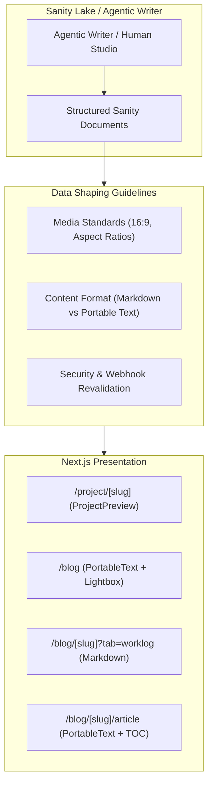

# System Architecture & Sanity Ingestion Index (`documentation/`)

**Date Started:** 2026-10-25  
**Status:** Active  

## 1. Purpose & Scope
This directory serves as the high-level architectural knowledge base for human developers and the **Agentic Writer**. It documents system design decisions, data-flow pipelines, and Sanity CMS ingestion contracts so authors can shape structured content correctly without needing raw prompt context bloat.

## 2. Architectural Blueprint & Data Pipeline

## 3. Document Navigation Index

| Document | Primary Domain | Core Invariant & Ingestion Guidance |
| :--- | :--- | :--- |
| [blog_page_architecture.md](./blog_page_architecture.md) | Blog Presentation | 3-column desktop layout, sticky right TOC, split-view Lightbox, and URL state sync. |
| [codebase_layout_and_routing.md](./codebase_layout_and_routing.md) | Routing & Layouts | App router directory topology, layout inheritance, and route group isolation. |
| [media_sizing_and_aspect_ratios.md](./media_sizing_and_aspect_ratios.md) | Asset Contracts | 16:9 banner standard, ambient blurred backdrop, and zero distortion cropping rules. |
| [markdown_and_portable_text_architecture.md](./markdown_and_portable_text_architecture.md) | Ingestion Standards | Schema format mapping: Portable Text for articles, Markdown for devlogs, AI approval gate. |
| [sanity_revalidate_webhook.md](./sanity_revalidate_webhook.md) | Cache Pipeline | HMAC SHA-256 signature verification and tag-based on-demand ISR revalidation. |
| [github_agent_runner_webhook.md](./github_agent_runner_webhook.md) | Webhook Intake | Phase 1 Gatekeeper, Web Crypto HMAC, Tier 1 filter, and workflow_dispatch. |
| [agent_runner_phase2_architecture.md](./agent_runner_phase2_architecture.md) | Background Worker | Phase 2 Ubuntu runner, dynamic .portfolio.json, Zod self-healing parser, and Sanity. |
| [agent_runner_phase3_publishing.md](./agent_runner_phase3_publishing.md) | Publishing & Grounding | Phase 3 Schema grounding, 3-Stage Map-Reduce synthesis, and instant ISR cache invalidation. |
| [gemini_quota_and_batch_distillation.md](./gemini_quota_and_batch_distillation.md) | Rate Limiting & Distillation | GeminiQuotaGuardrail sliding-window throttler, size-aware batching, and context retention. |
| [tracked_repository_setup_guide.md](./tracked_repository_setup_guide.md) | Repo Onboarding | Operational steps for env vars, GitHub Webhook setup, and .portfolio.json. |
| [resend_and_recaptcha_contact_system.md](./resend_and_recaptcha_contact_system.md) | Security & Delivery | Google reCAPTCHA v3 bot filtering, token rate limiting, and Resend email templates. |
| [mermaid_diagram_syntax_guide.md](./mermaid_diagram_syntax_guide.md) | Diagram Standards | DFD, flowchart, sequence, and state diagram specifications for Gemini/AI and humans. |
| [sanity_schema_grounding_and_mermaid_validator.md](./sanity_schema_grounding_and_mermaid_validator.md) | Schema & Diagram Safety | Complete field builders, hidden: true review gate, and stringent Mermaid grammar engine. |
| [agentic_pipeline_schema_and_mermaid_fixes.md](./agentic_pipeline_schema_and_mermaid_fixes.md) | Pipeline Hardening | Edge label quote sanitization, _weak: true, dynamic author directives, and direct publishing. |
| [dynamic_portfolio_json_specification.md](./dynamic_portfolio_json_specification.md) | Config Directives | Dynamic schema passthrough, author prompt directives, and file discovery rules. |
| [sanity_schema_agent_permissions.md](./sanity_schema_agent_permissions.md) | Agent Access Control | Schema permission matrix, zero-delete invariant, and RBAC guardrail boundary. |
| [sanity_milestone_history_digest.md](./sanity_milestone_history_digest.md) | Milestone Memory | Project-isolated GROQ tool, cumulative milestone detection, and article lifecycle decisions. |
| [agent_article_entry_creation.md](./agent_article_entry_creation.md) | Article Lifecycle | Landmark milestone evaluation, draft isolation, architecture addendums, and human approval gate. |
| [agentic_tool_registry_standardization.md](./agentic_tool_registry_standardization.md) | Autonomous Tool Calling | Bounded 2-turn tool loop, parallel dispatch, anti-hallucination project sandboxing, and Sanity/repo reader tools. |

## 4. Ingestion Guidelines for Agentic Writer
- **High-Level Orientation:** Use these docs to understand architectural trade-offs (e.g., why worklogs use Markdown while articles use Portable Text).
- **Asset Preparation:** Adhere strictly to media sizing contracts before submitting image/video references.
- **Approval Safety:** AI-authored articles must default to `hidden: true` pending human approval.
