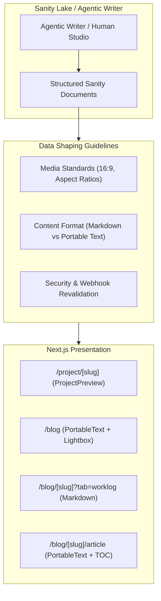

# System Architecture & Sanity Ingestion Index (`documentation/`)

**Date Started:** 2026-10-25  
**Status:** Active  

## 1. Purpose & Scope
This directory serves as the high-level architectural knowledge base for human developers and the **Agentic Writer**. It documents system design decisions, data-flow pipelines, and Sanity CMS ingestion contracts so authors can shape structured content correctly without needing raw prompt context bloat.

## 2. Architectural Blueprint & Data Pipeline

## 3. Document Navigation Index

| Document | Primary Domain | Core Invariant & Ingestion Guidance |
| :--- | :--- | :--- |
| [blog_page_architecture.md](./blog_page_architecture.md) | Blog Presentation | 3-column desktop layout, sticky right TOC, split-view Lightbox, and URL state sync. |
| [codebase_layout_and_routing.md](./codebase_layout_and_routing.md) | Routing & Layouts | App router directory topology, layout inheritance, and route group isolation. |
| [media_sizing_and_aspect_ratios.md](./media_sizing_and_aspect_ratios.md) | Asset Contracts | 16:9 banner standard, ambient blurred backdrop, and zero distortion cropping rules. |
| [markdown_and_portable_text_architecture.md](./markdown_and_portable_text_architecture.md) | Ingestion Standards | Schema format mapping: Portable Text for articles, Markdown for devlogs, AI approval gate. |
| [sanity_revalidate_webhook.md](./sanity_revalidate_webhook.md) | Cache Pipeline | HMAC SHA-256 signature verification and tag-based on-demand ISR revalidation. |
| [resend_and_recaptcha_contact_system.md](./resend_and_recaptcha_contact_system.md) | Security & Delivery | Google reCAPTCHA v3 bot filtering, token rate limiting, and Resend email templates. |

## 4. Ingestion Guidelines for Agentic Writer
- **High-Level Orientation:** Use these docs to understand architectural trade-offs (e.g., why worklogs use Markdown while articles use Portable Text).
- **Asset Preparation:** Adhere strictly to media sizing contracts before submitting image/video references.
- **Approval Safety:** AI-authored articles must default to `hidden: true` pending human approval.
