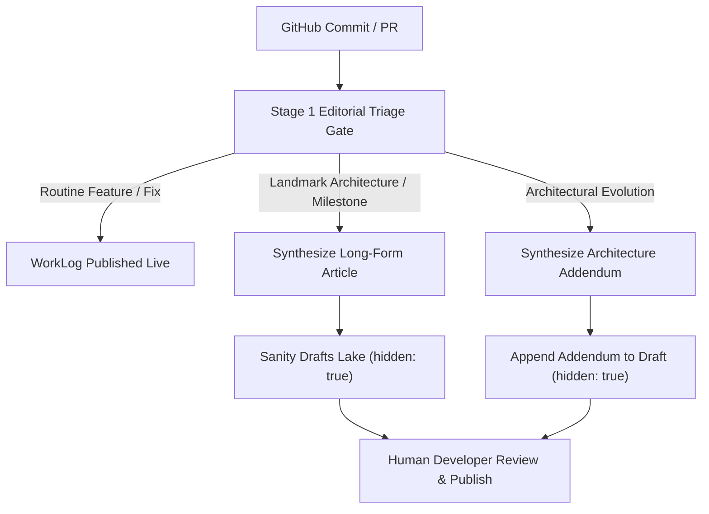

# Autonomous Agent Article Creation & Patching Pipeline

**Date Started:** 2026-11-07  
**Status:** Active  

## 1. Overview & Architecture
The Agentic Writer autonomously evaluates whether an engineering commit represents an incremental progress log (WorkLog only) or a landmark architectural milestone that warrants a long-form **Article** or an **Architecture Addendum** updating an existing article.

## 2. Landmark Milestone Decision Engine
Triage uses `fetchProjectHistoryDigest` to correlate recent worklogs with existing published articles:
- **`create_article`**: Triggered when a commit culminates a major architectural milestone (`Production Release`, `Architecture`, `Security`, or landmark multi-phase `Feature` completion) not yet covered by an existing article.
- **`update_article`**: Triggered when a commit fundamentally modifies or evolves an architecture documented in an existing article. Targets `targetArticleSlug` with a structured Addendum.
- **`none`**: Standard bug fixes, minor iterations, and incremental commits remain WorkLogs only.
- **Advisory Directive**: `"generateArticle": true` in `.portfolio.json` serves as an advisory signal; the agent independently validates technical substance before triggering article creation.

## 3. Strict Draft Isolation & Guardrail Invariants
All AI-authored articles and patches are subject to strict security invariants enforced by `sanityClientGuardrail.ts`:
1. **Drafts Namespace Only**: AI writes must target `drafts.article-${projectSlug}-${articleSlug}`. Direct creation of published articles is unconditionally blocked at runtime.
2. **Mandatory Approval Gate**: All created or patched article documents must have `hidden: true`. Articles remain completely invisible on the public site until a human reviews and unhides them in Sanity Studio.
3. **Zero Delete Authority**: The runner cannot delete or purge any existing article or worklog.

## 4. Structured Portable Text Transformation
Articles are transformed into Sanity Portable Text blocks with full schema compliance:
- **Sections**: Multi-paragraph narrative (`h2` headings, body paragraphs, and blockquotes).
- **Code Snippets**: Formatted inline or block code with file path citations.
- **Diagrams**: Validated Mermaid architecture flowcharts (omitted if `generateArchitectureDiagrams: false`).
- **Takeaways**: Bulleted engineering principles and architectural trade-offs.

