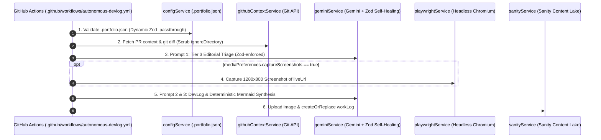

# Autonomous DevLog Agent Runner (Phase 2 & 4 Architecture)

**Date Started:** 2026-11-04  
**Status:** Implemented  

## 1. Overview
The Phase 2 Ephemeral Worker runs in GitHub Actions (`autonomous-devlog.yml`) on an Ubuntu runner. It fetches `.portfolio.json` contracts, executes Zod-constrained Gemini 3.5-Flash triage/synthesis with automated self-healing, captures Playwright screenshots, enforces deterministic Mermaid syntax, and publishes idempotent records to Sanity CMS.

## 2. Execution Pipeline

## 3. Deterministic Response Parser & Self-Healing Loop
All LLM operations enforce strict runtime safety via `scripts/agent_runner/parsers/aiResponseParser.ts`:
- **Dual Schema Enforcement:** Gemini API `responseSchema` (decoding constraint) + Zod runtime schemas (`TriageResponseSchema`, `DevLogSynthesisSchema`).
- **Self-Healing Loop (`executeWithSelfHealing`):**
  1. *Attempt 1:* Generates output at `temperature: 0.2`.
  2. *Validation Gate:* `extractZodDiagnostics` validates field types, string lengths, and array bounds.
  3. *Prompt 4 Self-Correction:* If invalid, drops to `temperature: 0.0` and sends targeted Zod error paths + malformed JSON back to the model (up to 3 attempts).

## 4. Deterministic Mermaid Syntax Contract
Mermaid diagrams follow strict rules to guarantee crash-free frontend rendering:
- **Allowed Types:** Strictly `flowchart TD` / `flowchart LR` or `sequenceDiagram`.
- **Quoted Node Labels:** All shape labels must use double quotes: `NodeA["Text"]`, `DB[("Storage")]`, `Check{"Condition?"}`.
- **Pipe Edge Syntax:** Edges with descriptions must use pipe notation: `A -->|"HTTPS"| B`.
- **No Inline Styles:** Forbids CSS styles, colors, `classDef`, or markdown backticks inside JSON strings.

## 5. Safeguards & Dynamic Extensibility
- **Dynamic `.portfolio.json`:** Requires `track`, `projectTitle`, `projectSlug`; dynamically passes custom properties downstream.
- **Diff Token Budget:** Truncates diff patches at 25,000 characters while preserving status lines.
- **Sanity Idempotency:** Uses `devlog-${projectSlug}-${commitSha.slice(0, 10)}` (or `drafts.` if `requireHumanApproval`).
- **Phase 4 Tool Registry Ready:** Modular interfaces in `tools/toolRegistry.ts` for future tool-calling agent capabilities.
