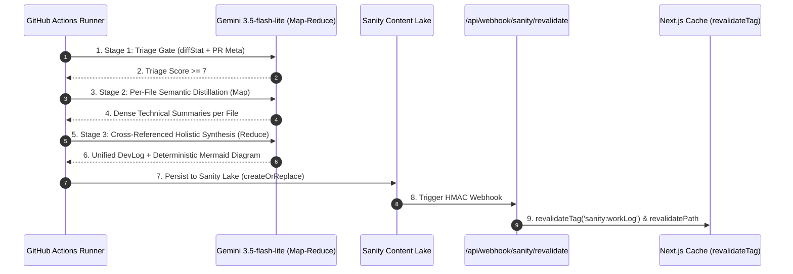

# Agentic Writer Phase 3: CMS Publishing & 3-Stage Map-Reduce

**Date Started:** 2026-11-05  
**Status:** Implemented  

## 1. Overview
Phase 3 establishes the **Agentic Writer** as an authorized, grounded content publisher into the Sanity Content Lake, enforcing strict schema access boundaries, a resilient 3-Stage Map-Reduce synthesis engine for large multi-file diffs, and instant Next.js ISR on-demand cache revalidation.

## 2. Invariant Schema Access Control
To protect curated portfolio identity, the agent enforces runtime schema boundaries:

| Access Tier | Schema Types | Policy |
| :--- | :--- | :--- |
| **Forbidden (Read-Only)** | `contact`, `emailContactInquiryTemplate`, `profile`, `summaryOverview`, `focusPillar`, `experience` | Agent mutations throw fatal `SchemaAccessViolationError`. |
| **Mandatory Draft** | `project`, `blog` | Always created as `drafts.*`; raises human review notification. |
| **Accessible Content** | `workLog`, `article` | Published directly (`devlog-*`), or drafted if `requireHumanApproval: true`. |

## 3. Invalidation & Publishing Pipeline

## 4. 3-Stage Map-Reduce Architecture
- **Stage 1 (Lightweight Triage):** Evaluates `git diff --stat`, commit messages, and PR metadata ($< 1,000$ tokens, $< 1.5$s) to filter routine housekeeping without reading large code bodies.
- **Stage 2 (Map - Per-File Distillation):** Compresses large, verbose source files (1,000+ lines) into dense, high-signal technical facts (core responsibilities, public exports, state mutations).
- **Stage 3 (Reduce - Cross-Referenced Synthesis):** Traces data flow across the distilled module summaries, synthesizing a unified narrative and a deterministic Mermaid diagram (`flowchart TD` or `sequenceDiagram`).

## 5. Anti-Fluff & Deterministic Prompt Contracts
- **Blacklist:** Strictly forbids AI marketing clichés ("Delve into", "In this fast-paced world", "Pivotal role", "Testament to", "A game-changer", "Revolutionary").
- **Grounded Writing:** Requires citing concrete filenames, exact function names, and verified architectural patterns (`HMAC-SHA256`, `Zod safeParse`).
- **Self-Healing Loop:** Automatically repairs invalid JSON via diagnostic feedback at `temperature: 0.0` across up to 3 attempts.

