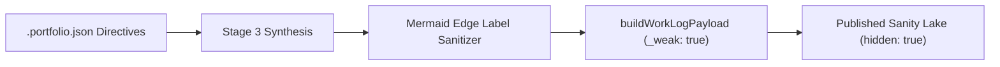

# Agentic Pipeline Schema Grounding & Mermaid Fixes

**Date Started:** 2026-11-06  
**Status:** Active  

## 1. Overview
Hardens the automated DevLog publishing pipeline against edge-case schema warnings, Mermaid rendering failures, and ungrounded project creations.

## 2. Key Architectural Invariants

### 1. Mermaid Edge Label Sanitization & Fences
- **Problem**: Edge labels with unescaped double quotes (e.g. `|"Display Report("stdout")"|`) broke `mermaid.render()`.
- **Invariant**: Edge labels inside `|...|` are automatically sanitized to single quotes (`'stdout'`).
- **Prompt Directive**: Explicitly prohibits nested double quotes and Unicode arrow glyphs (`→`). Only standard ASCII arrows (`-->`, `-.->`, `==>`) are permitted.

### 2. Sanity Reference Weakness (`_weak: true`)
- **Schema Match**: `src/sanity/schemas/workLog.ts` defines `project` with `weak: true`.
- **Payload Invariant**: `buildWorkLogPayload` sets `_weak: true` on parent project references to eliminate Sanity Studio reference strength warnings.

### 3. Undeclared Field Exclusion
- **Invariant**: The `projectSlug` string property is removed from the root of `workLog` payloads, avoiding "Unknown field found" warnings in Studio.

### 4. Direct Publishing with `hidden: true`
- **Draft Disconnect Resolution**: WorkLogs are published directly (`_id: devlog-...`) rather than queued as Sanity drafts.
- **Human Review Gate**: Parent projects are created with `hidden: true`, preventing public UI rendering until approved by a human operator in Studio while maintaining 100% referential integrity.

### 5. Dynamic `.portfolio.json` Directives & Project Synthesis
- **Dynamic Ingestion**: Custom `.portfolio.json` keys (e.g. `userMessage`, `customAudience`) are passed to Gemini Stage 3 as top-priority directives.
- **Parent Grounding**: Initial project creation populates `techStacks: string[]` and a professional `projectOverview` adhering to user instructions over raw fallback notes.

