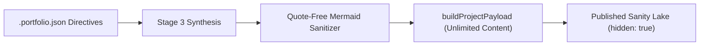

# Agentic Pipeline Schema Grounding & Mermaid Fixes

**Date Started:** 2026-11-06  
**Status:** Active  

## 1. Overview
Hardens the automated DevLog publishing pipeline against schema warnings, Mermaid rendering crashes, and ungrounded project creations.

## 2. Key Architectural Invariants

### 1. Quote-Free Mermaid Edge Labels
- **Problem**: Edge labels with quotes (e.g. `|"Display Report(" 'stdout' ")"|`) broke `mermaid.render()`.
- **Invariant**: Edge labels inside pipes `|...|` must be clean, quote-free text (e.g. `-->|Display Report (stdout)|`). The sanitizer strips all quote marks within `|...|` and replaces `::` in node labels with `:` to prevent class operator conflicts.
- **Connectors**: Strictly ASCII arrows (`-->`, `-.->`, `==>`). Never Unicode glyphs (`→`).

### 2. Unlimited Portable Text Content & `dateStarted`
- **Field Separation**: `shortDescription` is strictly capped at $\le 280$ characters for summary cards. In contrast, `content` (Portable Text) receives the full, untruncated narrative with **no text limit**.
- **Inception Date**: `dateStarted` (`YYYY-MM-DD`) is automatically populated on project creation.

### 3. Sanity Reference Weakness (`_weak: true`)
- **Schema Match**: `src/sanity/schemas/workLog.ts` defines `project` with `weak: true`.
- **Payload Invariant**: `buildWorkLogPayload` sets `_weak: true` on parent project references to eliminate Sanity Studio reference strength warnings.

### 4. Undeclared Field Exclusion
- **Invariant**: The `projectSlug` string property is removed from the root of `workLog` payloads, avoiding "Unknown field found" warnings in Studio.

### 5. Direct Publishing with `hidden: true`
- **Draft Disconnect Resolution**: WorkLogs publish directly (`_id: devlog-...`) to Content Lake.
- **Human Review Gate**: Parent projects are created with `hidden: true`, preventing public UI rendering until approved by a human operator in Studio while maintaining 100% referential integrity.

### 6. Dynamic `.portfolio.json` Directives & Project Synthesis
- **Dynamic Ingestion**: Custom `.portfolio.json` keys (e.g. `userMessage`, `customAudience`) are passed to Gemini Stage 3 as top-priority directives.
- **Parent Grounding**: Initial project creation populates `techStacks: string[]` and a professional `projectOverview` adhering to user instructions over raw fallback notes.
