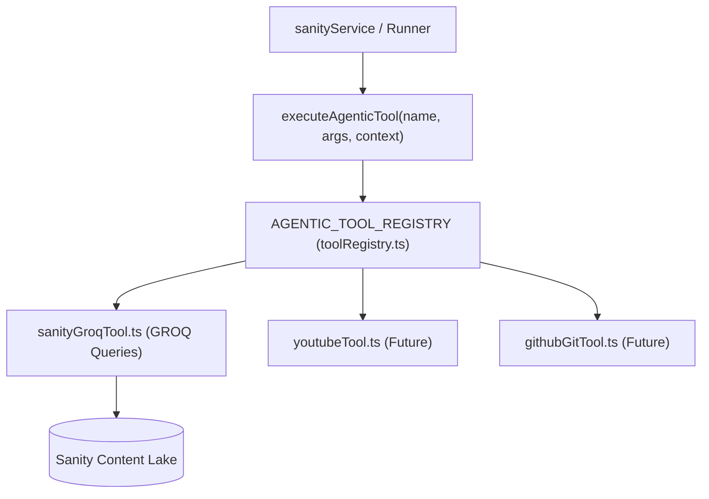

# Standardized Agentic Tool Calling & Registry Architecture

**Date Started:** 2026-11-10  
**Status:** Active  

## 1. Overview & Architecture
The Agentic Tool Registry consolidates autonomous runner capabilities into modular, single-responsibility tool files under `scripts/agent_runner/agentic_tools/`. All tools register in a centralized `toolRegistry.ts` that enforces typed parameter schemas matching OpenAI / Gemini function-calling standards.



## 2. Standardized Tool Interface Contract
Every agentic tool implements `AgenticToolDeclaration` and accepts a typed `ToolContext`:

```typescript
export interface ToolContext {
  targetRepo?: string;
  commitSha?: string;
  projectSlug?: string;
  sanityClient?: SanityClient;
}

export interface AgenticToolDeclaration<TArgs = Record<string, unknown>, TResult = unknown> {
  name: string;
  description: string;
  parameters: {
    type: 'object';
    properties: Record<string, { type: string; description: string; enum?: readonly string[] }>;
    required: string[];
  };
  execute: (args: TArgs, context: ToolContext) => Promise<TResult>;
}
```

## 3. Registered Sanity GROQ Tools
- **`fetch_project_history_digest`**: Executes an ultra-compact (< 150 tokens) GROQ projection isolated to `projectSlug == $slug`. Returns past worklog badges, commit hashes, and existing article slugs.
- **`fetch_article_by_slug`**: Fetches full article content blocks, excerpts, and metadata by unique slug from Sanity Lake for grounding and architecture addendum patch synthesis.

## 4. Standardized Service Consumption
Services invoke tools via the centralized dispatcher rather than direct module coupling:

```typescript
const digest = await executeAgenticTool<ProjectHistoryDigest>(
  'fetch_project_history_digest',
  { projectSlug },
  { projectSlug, sanityClient: client }
);
```

