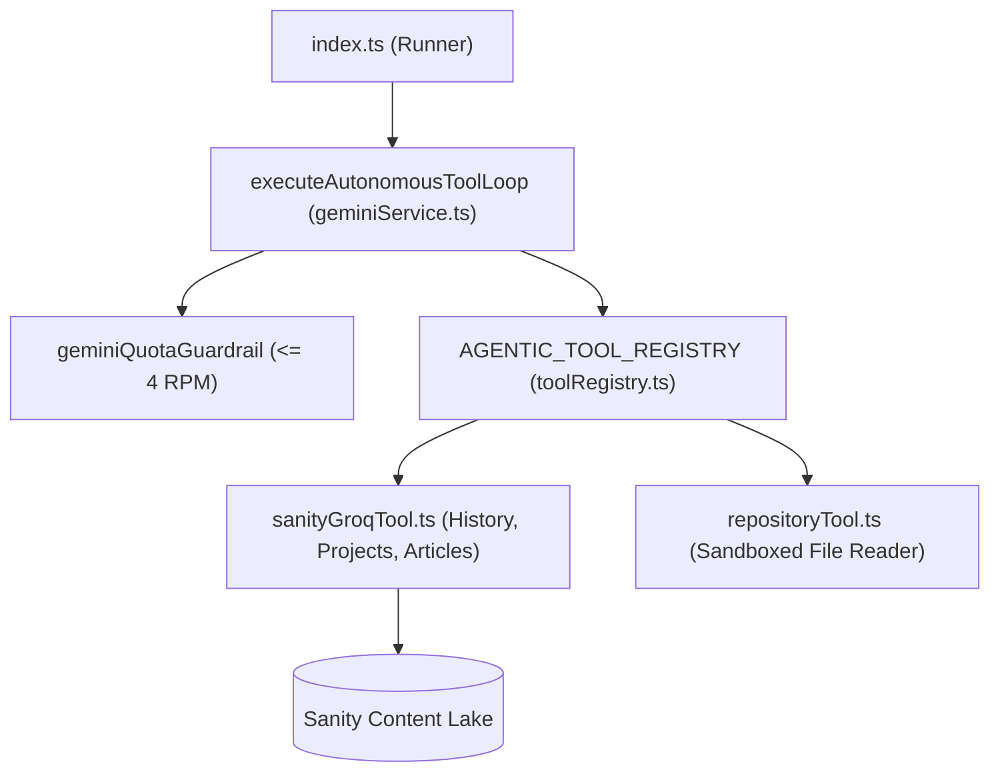

# Standardized Agentic Tool Calling & Registry Architecture

**Date Started:** 2026-11-10  
**Status:** Active  

## 1. Overview & Autonomous Tool Engine
The Agentic Tool Registry consolidates autonomous runner capabilities into modular tools under `scripts/agent_runner/agentic_tools/`. Gemini invokes these via an autonomous 2-turn bounded loop (`executeAutonomousToolLoop`) with parallel dispatch, strict project sandboxing, and sliding-window rate limit guardrails.



## 2. Standardized Tool Interface Contract
Every tool implements `AgenticToolDeclaration` and accepts a typed `ToolContext`:

```typescript
export type ToolScope = 'triage' | 'synthesis' | 'all';

export interface ToolContext {
  targetRepo?: string;
  commitSha?: string;
  projectSlug?: string;
  sanityClient?: SanityClient;
  repoRoot?: string;
}

export interface AgenticToolDeclaration<TArgs = Record<string, unknown>, TResult = unknown> {
  name: string;
  description: string;
  scopes?: ToolScope[];
  parameters: {
    type: 'object';
    properties: Record<string, { type: string; description?: string; enum?: readonly string[] }>;
    required: string[];
  };
  execute: (args: TArgs, context: ToolContext) => Promise<TResult>;
}
```

## 3. Registered Autonomous Tools
- **`fetch_project_history_digest`** (Scopes: `triage`, `synthesis`): GROQ projection (< 150 tokens) isolated to `projectSlug` for cumulative milestone tracking.
- **`fetch_article_by_slug`** (Scopes: `triage`, `synthesis`): Retrieves article content sandboxed to the active project for architecture addendum synthesis.
- **`fetch_sanity_projects`** (Scopes: `triage`, `synthesis`): Lists registered projects (title, slug, repository) so the agent can autonomously verify or resolve the canonical slug.
- **`read_repository_file`** (Scopes: `triage`, `synthesis`): Safely reads up to 200 lines of source code. Blocks path traversal and sensitive files (`.env`, `.git/`).

## 4. Execution Invariants & Safety Guardrails
1. **Bounded 2-Turn Tool Loop:** Turn 1 executes tool inquiries in parallel (`Promise.all`). Turn 2 generates strict Zod-validated JSON output (`responseSchema`).
2. **Rate Limit Pacing:** Every Gemini API turn is gated by `geminiQuotaGuardrail.waitForAvailableSlot()` to protect the Google AI Studio 5 RPM ceiling.
3. **Anti-Hallucination Sandboxing:** Queries strictly bind to `context.projectSlug`. Cross-project access is blocked.
4. **Sanity RBAC Invariants:** Zero delete authority; articles authored by agents must enforce the `drafts.` prefix.
