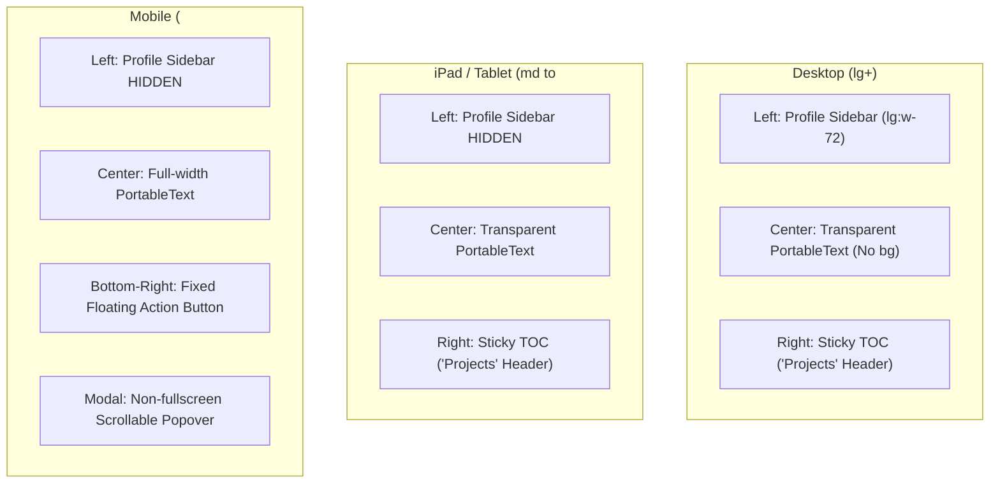

# Software Engineer Blog Page Architecture (`/blog`)

**Date Started:** 2026-10-23  
**Status:** Implemented  

## 1. Overview
The `/blog` route provides a dedicated engineering background of works for Benji as a Software Engineer. It renders portable text with extensible standalone media blocks, a sticky/floating "Projects" Table of Contents, and a progressive URL state-synced split-view Lightbox modal.

## 2. Responsive Layout Pipeline

## 3. Extensible Media & Lightbox Modal
- **Standalone Media Schema:** Reusable across images, native Sanity video, YouTube, and Vimeo with `title`, `description`, `backlinks` (with platform icons), `readTime`, and `publishedAt`.
- **Desktop & iPad Lightbox:** Split view with 70% zoomable media canvas and a 30% fixed, independently scrollable Right-Side Details Panel updating dynamically on gallery navigation.
- **Mobile Lightbox:** Fullscreen media canvas with a bottom gradient OVERLAY (**no card container**) and an inline `Read more...` expander for long descriptions.
- **Progressive URL State:** `?media=<key>` and `?play=<key>` URL query synchronization preserves active lightbox and video playback states across browser hard reloads.

