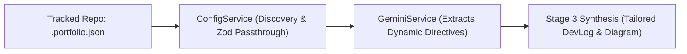

# Dynamic `.portfolio.json` Specification & Prompt Directives

**Date Started:** 2026-11-06  
**Status:** Active  

## 1. Overview
The `.portfolio.json` configuration file acts as the bridge between tracked repositories and the autonomous DevLog agent. It uses schema passthrough (`.passthrough()`) to allow developers to pass arbitrary metadata and custom prompt directives directly to the AI writer.



## 2. Core Required Fields

| Field | Type | Required | Description |
| :--- | :--- | :--- | :--- |
| `track` | boolean | Yes | Enables automated DevLog tracking for this repository. |
| `projectTitle` | string | Yes | Human-readable title for project and devlog grouping. |
| `projectSlug` | string | Yes | Unique URL identifier linking WorkLogs to Sanity projects. |
| `category` | string | No | Domain classification (e.g. `Automation`, `Edge AI`, `Web`). |
| `primaryBranch` | string | No | Branch to track (defaults to `main`). |
| `requireHumanApproval` | boolean | No | If true, logs require manual review before public display. |

## 3. Dynamic Author Directives

Any non-standard key added to the JSON is dynamically extracted and passed into Gemini Stage 3 as a high-priority prompt directive under `CRITICAL AUTHOR DIRECTIVES`.

### Supported Structures

1. **Direct Instructions (`userMessage`):**
   ```json
   "userMessage": "Focus on connection pooling and HTTP 429 backoff rather than routine syntax."
   ```
2. **Target Audience (`customAudience`):**
   ```json
   "customAudience": "Senior Systems Engineers & Technical Recruiters"
   ```
3. **Structured Arrays (`focusAreas`, `keyModules`):**
   ```json
   "focusAreas": ["Socket Reuse", "Headless Status Verification", "STDOUT Formats"]
   ```
4. **Nested Objects (`editorialPreferences`):**
   ```json
   "editorialPreferences": {
     "tone": "Deeply technical, zero buzzwords",
     "emphasizeDiagram": "Worker pool thread dispatch"
   }
   ```

## 4. File Discovery Rules
- The runner first checks root for `.portfolio.json`.
- If absent, it searches root for `*.portfolio.json` (e.g. `this.portfolio.json`) or `portfolio.json`.

