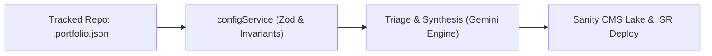

# Dynamic `.portfolio.json` Specification & Communication Bridge

**Date Started:** 2026-11-06 (Updated: 2026-11-07) | **Status:** Active

## 1. Overview
The `.portfolio.json` file serves as a bidirectional communication bridge between developers and the autonomous DevLog agent. It enforces execution boundaries while giving the agent autonomy to decide missing project attributes.

## 2. Tiered Field Architecture

### Tier 1: Required Governance Invariants
| Field | Type | Requirement | Description |
| :--- | :--- | :--- | :--- |
| `track` | `boolean` | **Required** | Kill switch. If false, drops execution immediately. |
| `requireHumanApproval` | `boolean` | **Required** | Stages with `hidden: true` if true. Accepts `requiredHumanApproval`. |
| `mediaPreferences` | `object` | **Required** | Requires `{ captureScreenshots: boolean, generateArchitectureDiagrams: boolean }`. |

### Tier 2: Dual-Mode Keys (Human Override OR Agent Decides)
| Field | Type | Default / Agent Autonomous Fallback |
| :--- | :--- | :--- |
| `primaryBranch` | `string` | Defaults to `"main"`. Other branches are skipped. |
| `projectTitle` | `string` | If omitted, Agent autonomously synthesizes title from repo & code. |
| `projectSlug` | `string` | If omitted, Agent derives slug from title or repo name. |
| `category` | `string` | If omitted, Agent classifies domain from tech stack. |
| `liveUrl` | `string` | Triggers Playwright headless capture if `captureScreenshots` is true. |
| `ignoreDirectory` | `string[]` | Paths to exclude from git diff processing (defaults to `[]`). |

### Tier 3: Communication Bridge (Standing Context vs Commit Steering)
| Field | Scope | Impact on AI Writer |
| :--- | :--- | :--- |
| `projectOverview` | **Persistent** | Informs standing project identity and purpose across all runs (`note`). |
| `developerDirective` | **Ephemeral** | Top priority steering for the *current* commit/PR (`userMessage`). |
| `targetAudience` | **Tone/Depth** | Calibrates technical vocabulary & depth (`customAudience`). |

### Tier 4: Dynamic Arbitrary Parameters
Any additional key (e.g. `writingTone`, `customTags`) is preserved via `.passthrough()` and injected into Gemini prompts as `- Dynamic Parameter [<key>]: "<value>"`.

## 3. Discovery & JSONC Support
- Probes root for `.portfolio.json`, falling back to `*.portfolio.json` or `portfolio.json`.
- Supports standard JSON and JSON with comments (JSONC: `//` and `/* */`).
