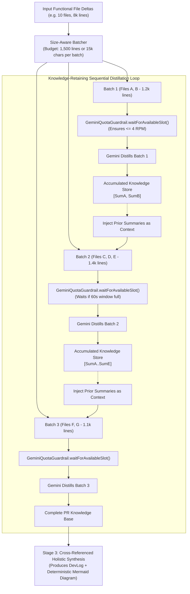

# Gemini Quota Guardrail & Size-Aware Batch Distillation

**Date Started:** 2026-11-05  
**Status:** Implemented  

## 1. Overview
Defines the rate-limiting and code-distillation architecture that protects the Agentic Writer from exceeding Google AI Studio's Free Tier 5 Requests Per Minute (5 RPM) ceiling while preserving 100% of multi-file engineering context across massive pull requests.

## 2. Architecture & Knowledge-Retaining Data Flow

## 3. Core Components

### A. GeminiQuotaGuardrail (`scripts/agent_runner/utils/geminiQuotaGuardrail.ts`)
- **Sliding-Window Timestamp Queue:** Tracks request timestamps over a rolling 60-second window.
- **Safe 4 RPM Ceiling:** Guarantees a 1-request buffer below Google's 5 RPM limit.
- **Predictive Slot Waiting:** If 4 requests occur within 60s, automatically pauses execution until the oldest request slot expires.
- **Dynamic 429 Recovery:** Parses Google's `RetryInfo.retryDelay` (e.g. `53s`) and sleeps the requested duration.

### B. Size-Aware Dynamic Batcher (`groupFileDeltasIntoSizeBatches`)
- Groups files dynamically by code density rather than fixed counts (max 1,500 lines or 15,000 characters).
- 10 small files (500 lines total) merge into **1 single batch**.
- 10 large files (8,000 lines total) dynamically partition into **4–5 balanced batches**.

### C. Stateful Knowledge Retention
- As each batch completes, its distilled facts append to `accumulatedSummaries`.
- Subsequent batches receive `PREVIOUSLY ANALYZED MODULES IN THIS PR`, enabling Gemini to connect dependencies across batches without context loss.

### D. 503 High-Demand Failover & Quota Rollback
- **Quota Rollback:** Transient 503 or network drops invoke `rollbackSlot()`, preventing server-side errors from saturating client RPM slots.
- **Dynamic Model Failover:** If `gemini-2.5-flash` encounters repeated 503 surges, the pipeline switches to `gemini-2.0-flash` or `gemini-1.5-flash` with jittered exponential backoff.

