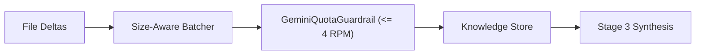

# Gemini Quota Guardrail & Size-Aware Batch Distillation

**Date Started:** 2026-11-05  
**Status:** Implemented  

## 1. Overview
Defines rate-limiting and code-distillation architecture protecting the Agentic Writer from exceeding Google AI Studio's Free Tier RPM and RPD ceilings while preserving 100% of multi-file context.

## 2. Core Components

### A. GeminiQuotaGuardrail (`geminiQuotaGuardrail.ts`)
- **Safe 4 RPM Sliding Window:** Tracks request timestamps over rolling 60s window.
- **Predictive Slot Waiting:** Pauses execution if 4 requests occur within 60s until oldest slot expires.
- **60-Second Max Backoff Ceiling:** Rejects any `retryDelay > 60s` immediately as `DAILY_QUOTA_EXHAUSTED`, preventing runner freezes on multi-hour daily quota resets.

### B. Size-Aware Dynamic Batcher (`geminiService.ts`)
- Partitions files by token density (max 1,500 lines or 15,000 characters per batch).
- Small commits merge into 1 batch; large multi-file diffs partition into balanced batches.

### C. Stateful Knowledge Retention
- Distilled per-batch facts append to `accumulatedSummaries`.
- Subsequent batches receive prior module summaries to connect cross-module imports without context loss.

### D. Model Failover & Daily Quota Resilience
- **Production Model Default:** Defaults to `gemini-3.5-flash-lite` for **1,500 requests/day** free tier stability.
- **Instant Quota Failover:** When `DAILY_QUOTA_EXHAUSTED` or persistent 503 errors occur, the runner immediately switches to `gemini-2.0-flash` without multi-hour sleeps.
- **Quota Rollback:** 503 surges invoke `rollbackSlot()` to avoid burning client RPM quotas on server errors.
