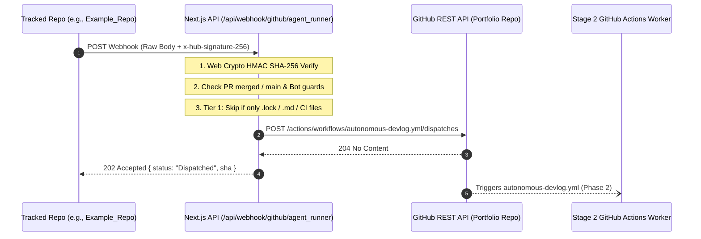

# GitHub Agent Runner Webhook Intake (Phase 1)

**Date Started:** 2026-11-04  
**Status:** Implemented  

## 1. Overview
Stage 1 Serverless Gatekeeper that receives GitHub `push` and `pull_request` events from tracked project repositories, performs Web Crypto HMAC verification, runs deterministic Tier 1 filtering, and dispatches to Stage 2 (`autonomous-devlog.yml`) within `< 1s`.

## 2. Invalidation & Intake Pipeline



## 3. Webhook Registration Details
- **Endpoint:** `https://<DOMAIN>/api/webhook/github/agent_runner`
- **Content Type:** `application/json`
- **Secret:** `GITHUB_WEBHOOK_SECRET`
- **Events:** `Pull requests` (closed/merged) and `Pushes` (default branch)

## 4. Tracked Repo Contract (`.portfolio.json`)
```json
{
  "track": true,
  "$schema": "https://benjibenji20.dev/schemas/portfolio.v1.json",
  "requireHumanApproval": true,
  "note": "Do not make your blog super technical",
  "ignoreDirectory": ["/public/assets/"],
  "projectTitle": "Incident Hound",
  "projectSlug": "incident-hound",
  "category": "Backend Systems & Observability",
  "liveUrl": "https://incident-hound.demo.dev",
  "primaryBranch": "main",
  "mediaPreferences": {
    "captureScreenshots": false,
    "generateArchitectureDiagrams": true
  }
}
```

## 5. Key Invariants & Security
- **Sub-Second Execution:** Runs within a 1.5s serverless ceiling using `AbortSignal.timeout(3000)`.
- **Payload Discipline:** Forwards compact metadata (`target_repo`, `commit_sha`, `pr_number`, `branch`, `pr_title`) respecting GitHub's 1024-character input ceiling. Full diffs/PR bodies are pulled in Phase 2.
- **Web Crypto Verification:** Constant-time `crypto.subtle.verify` prevents timing attacks.

