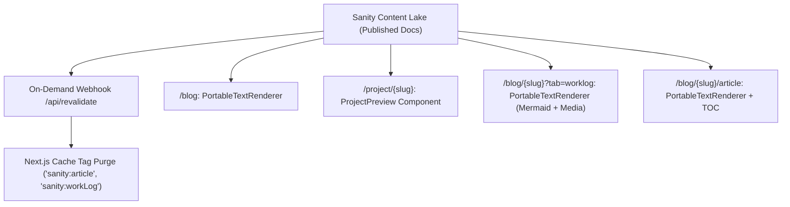

# Content Rendering Architecture: Markdown & Portable Text

**Date Started:** 2026-10-25  
**Status:** Implemented  

## 1. Overview
Defines the content rendering paradigm across `/project/{slug}`, `/blog`, `/blog/{slug}`, and `/blog/{slug}/article`. Balances rich multimedia storytelling (Sanity Portable Text) with rapid, low-friction developer milestone logging (Markdown / plain text).

## 2. Route & Content Format Matrix

| Route | Sanity Schema | Content Format | Purpose & Rendering |
| :--- | :--- | :--- | :--- |
| `/project/{slug}` | `project` | Structured + Portable Text | Top `ProjectPreview` banner with bottom technical body narrative (`content`), right sidebar TOC, and media lightbox. |
| `/blog` | `blog` | Portable Text | Personal engineer blog with embedded media blocks, sticky TOC, and split Lightbox. |
| `/blog/{slug}?tab=articles` | `article` | Cards (`excerpt`) | 2x2 article preview cards with strictly locked heights and scroll-y excerpt details. |
| `/blog/{slug}?tab=worklog` | `workLog` | Portable Text (Text fallback) | Changelog entries rendered via `PortableTextRenderer` with Mermaid diagrams, screenshots, videos, and collapsible metadata footer. |
| `/blog/{slug}/article` | `article` | Portable Text | Deep-dive technical articles using `PortableTextRenderer`, dynamic TOC, and Lightbox. |

## 3. Data Flow & Publishing Lifecycle

## 4. Key Publishing Invariants & Moderation
- **Sanity Publish Requirement:** Only documents published in the Sanity Content Lake (`drafts.` filtered out by GROQ) are fetched and rendered by Next.js.
- **Agentic Writer Approval Gate:** `article` documents authored by AI default to `hidden: true`. Human review in Sanity Studio is required to toggle `hidden: false` before public rendering.
- **Project Linkage:** Both `article` and `workLog` documents reference their parent project via `project: { type: 'reference', to: [{ type: 'project' }] }` with fallback on `projectSlug`.
- **Media Asset Projection:** GROQ queries dereference `asset->{ _id, url }` to hydrate cover images and media carousels with direct URLs for `<AmbientImage>` and `<ProjectMediaCarousel>`.
- **Studio Blockquote Decorator:** In Sanity Studio v3 under React 19, default blockquote renders `
` wrapping `<TextContainer>` (`
`), causing DOM nesting violations. All portable text schemas register `StudioBlockQuote` on `{ title: 'Quote', value: 'blockquote' }` to render clean semantic `<blockquote>` tags.
