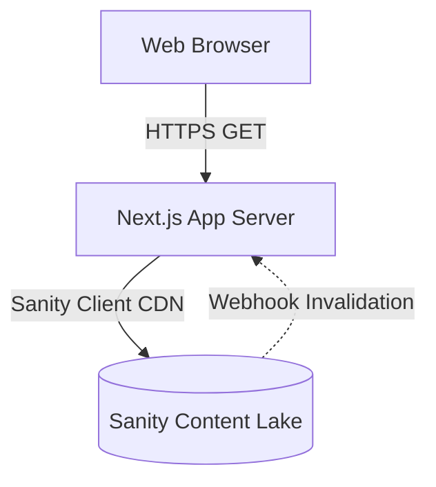
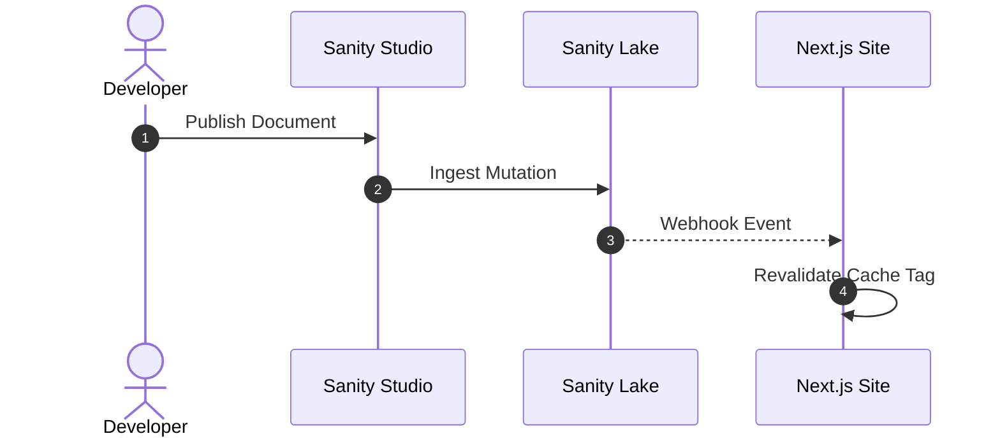
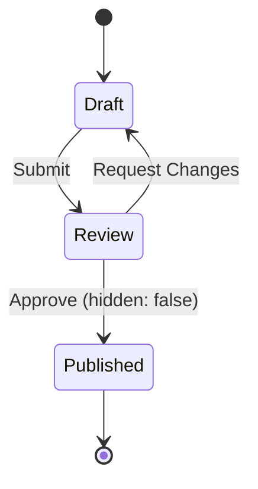

# Mermaid Diagram Syntax & Authoring Guide

**Date Started:** 2026-10-25  
**Status:** Implemented  

## 1. Overview
Standard guide for rendering architecture, data flow (DFD), sequence, and state diagrams across `/blog`, `/blog/{slug}/article`, and `/blog/{slug}?tab=worklog` using `MermaidRenderer`.

## 2. Diagram Syntax Specifications

### A. Flowchart & Data Flow Diagram (DFD)
Use `flowchart TD` (Top-Down) or `flowchart LR` (Left-to-Right). Define nodes with distinct shape delimiters:
- `[Rectangle]` for standard processing steps
- `(Rounded)` for entrypoints/terminals
- `[(Cylinder)]` for databases / persistent storage
- `>Flag]` or `{Diamond}` for routing / decision conditions



### B. Sequence Diagram
Use `sequenceDiagram` with `autonumber`, `participant`, and directional arrows (`->>`, `-->>`, `->`):



### C. State Diagram
Use `stateDiagram-v2` for lifecycle states (e.g. publication and review):



## 3. Authoring Formats & Critical Invariants

> **CRITICAL RULE: Line Breaks Between Statements**  
> Mermaid grammar is line-oriented. Each statement (e.g. `flowchart TD`, `A --> B`, `actor ...`) requires a line break (use `Shift + Enter` in Sanity Studio). While `PortableTextRenderer` auto-formats single-line inputs, standard multiline authoring is the official contract.

1. **Standard Fenced Block (Gemini / AI / Humans):**
   ```mermaid
   flowchart LR
     A --> B
   ```
2. **Direct Sanity Code Object:**
   `{ _type: 'code', language: 'mermaid', code: "flowchart LR\n  A --> B" }`
3. **Studio Portable Text Block:**
   Enter the diagram with line breaks (Shift+Enter). Code decorator `<>` is optional.

