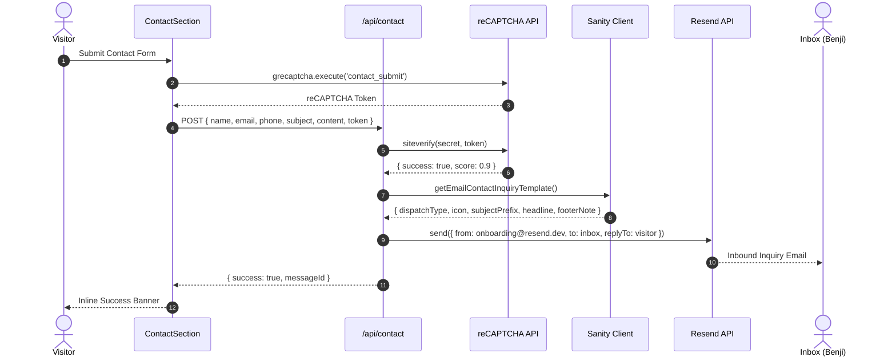

# Contact Dispatcher & reCAPTCHA v3 Architecture

**Date Started:** 2026-10-23  
**Status:** Implemented  

## 1. Overview
Defines the serverless contact dispatching architecture combining Resend outbound email delivery with Google reCAPTCHA v3 bot mitigation and a dedicated Sanity singleton schema (`emailContactInquiryTemplate`).

## 2. Dispatch & Bot Defense Pipeline

## 3. Key Invariants & Configurations
- **Sandbox Sender / No Custom Domain:** Dispatches from `onboarding@resend.dev` to personal email (`RESEND_PERSONAL_EMAIL` / `RESEND_TO_EMAIL`) with `replyTo: visitorEmail` to enable direct replies.
- **Bot Defense Threshold:** Calibrated to `score >= 0.5` on action `contact_submit`. Requests scoring below are rejected with `403 Forbidden`.
- **Badge Visibility & TOS Compliance:** Floating `.grecaptcha-badge` is hidden via CSS (`visibility: hidden !important;`), accompanied by explicit Google Terms and Privacy links below the form.
- **Dedicated Template Singleton:** Decoupled into `emailContactInquiryTemplate` document featuring `dispatchType` (fallback: `'Visitor Contact Email'`), optional `icon`, `subjectPrefix`, `headline`, and `footerNote`.
- **State Preservation:** Inputs remain preserved if an error or low confidence score occurs, preventing visitor draft loss.
