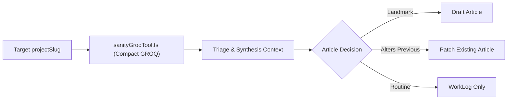

# Sanity Milestone History Digest & Agentic Tooling

**Date Started:** 2026-11-07 | **Status:** Active

## 1. Overview
The Milestone History Digest provides the autonomous DevLog agent with chronological memory of past runs for a specific project. It eliminates commit amnesia, enabling the agent to recognize when an incremental push culminates into a major feature milestone or alters an existing article's architecture.



## 2. Extensible Tool Layer (`agentic_tools/sanityGroqTool.ts`)
To prevent multi-turn LLM tool-calling loops and quota exhaustion, the runner uses **deterministic pipeline injection**:
- Executes a single, sub-50ms GROQ projection fetching the last 3-4 worklogs and published article summaries.
- Payload is strictly constrained to `< 150` tokens, giving full chronological context without risking Gemini rate limits.
- The `agentic_tools/` directory serves as the modular foundation for future agentic data tools.

## 3. Strict Project Isolation Invariant
All history queries are strictly parameter-bound to `$slug`:
```groq
*[_type == "workLog" && (project->slug.current == $slug || projectSlug == $slug)] | order(date desc)[0..3]
```
The agent is deterministically blocked from reading other projects' schemas or logs, eliminating cross-project context pollution.

## 4. Article Lifecycle Decision Matrix
Stage 1 Triage evaluates the current commit against historical milestones:
- **`none`**: Standard engineering progress; persisted as a WorkLog only.
- **`create_article`**: The commit culminates a major zero-to-one architecture, breakthrough feature, or `"generateArticle": true` is specified. Staged in `drafts.article-*`.
- **`update_article`**: An architectural change modifies or supersedes an already-documented system; targets `targetArticleSlug` with a proposed architecture update.

## 5. Memory Architecture: Lake Persistence vs. LLM Context Cache
Google Gemini Context Caching (`cachedContent`) mandates a minimum threshold of 32,768 tokens and carries hourly expiration fees. Because agent runs are compact (2.5k–8k tokens) and run intermittently in ephemeral GitHub Actions, Sanity Content Lake serves as the permanent, zero-cost distributed memory.

