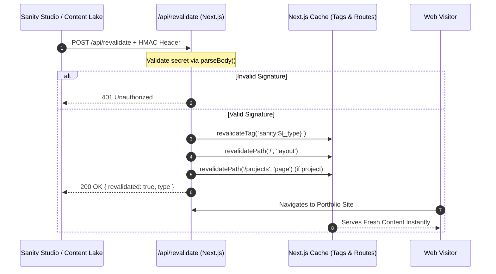

# Sanity On-Demand Revalidation Webhook Architecture

**Date Started:** 2026-10-23  
**Status:** Implemented  

## 1. Overview
Provides instantaneous on-demand cache revalidation across Next.js ISR and `'use cache'` functions whenever content is published, updated, or deleted in the Sanity Content Lake.

## 2. Invalidation Flow Pipeline



## 3. Webhook Registration Details
- **Target URL Endpoint:** `https://<DOMAIN>/api/revalidate` (or tunnel for local dev)
- **HTTP Method:** `POST`
- **Secret:** Value of `SANITY_REVALIDATE_SECRET` environment variable
- **Trigger on:** Create, Update, Delete
- **Filter (GROQ):**
  ```groq
  _type in [
    "profile",
    "summaryOverview",
    "focusPillar",
    "experience",
    "project",
    "contact",
    "emailContactInquiryTemplate"
  ]
  ```

## 4. Key Invariants & Security
- **HMAC Verification:** Uses `@sanity/webhook` via `next-sanity/webhook`'s `parseBody()` to authenticate callers.
- **Hierarchical Revalidation:** Invokes `revalidateTag` for scoped tag caches (`sanity:${_type}`) and `revalidatePath('/', 'layout')` to purge cached layout trees, navigation headers, and pages simultaneously.
