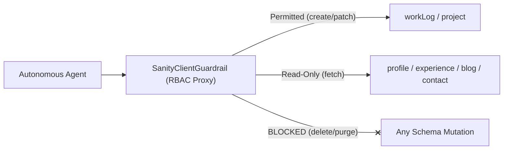

# Sanity Schema Agent Permissions & Access Guardrails

**Date Started:** 2026-11-07  
**Status:** Active  

## 1. Overview
Defines the Principle of Least Privilege for autonomous agents interacting with Sanity Content Lake. Restricts AI write/mutate capabilities to safe logging schemas, while locking core profile, settings, and templates to read-only access.

## 2. Schema Access Matrix

| Schema Type | Document Name | Allowed Agent Actions | Forbidden Actions | Purpose & Security Scope |
| :--- | :--- | :--- | :--- | :--- |
| `workLog` | Work Logs | **Read, Create, Patch** | Delete | Primary logging surface. Append-only technical devlogs. |
| `project` | Projects | **Read, Create, Patch** | Delete | Grounding & discovery. Create only with `hidden: true`. |
| `article` | Deep Articles | **Read, Create (Draft)** | Delete, Publish | Human-in-the-loop technical longform drafting. |
| `profile` | Profile / Bio | **Read-Only** | Create, Patch, Delete | Immutable developer identity, avatar, headline. |
| `summaryOverview` | Overview Stats | **Read-Only** | Create, Patch, Delete | Immutable career metric counters and overview text. |
| `focusPillar` | Focus Pillars | **Read-Only** | Create, Patch, Delete | Immutable architectural disciplines and domains. |
| `experience` | Work Experience | **Read-Only** | Create, Patch, Delete | Immutable company roles, milestones, and dates. |
| `blog` | Blog Settings | **Read-Only** | Create, Patch, Delete | Immutable blog root metadata and presentation settings. |
| `contact` | Contact Endpoints | **Read-Only** | Create, Patch, Delete | Immutable social handles, endpoints, and channels. |
| `emailContactInquiryTemplate` | Email Templates | **Read-Only** | Create, Patch, Delete | Immutable email contact layouts and form formats. |

## 3. Global Agent Invariants
1. **Zero Delete Authority:** Autonomous agents are unconditionally forbidden from calling `delete()` or purging any document across the entire Content Lake.
2. **Hidden Project Gate:** Any project entry created by an agent must enforce `hidden: true` pending human verification in Sanity Studio.
3. **Draft Article Isolation:** Articles generated by AI agents must strictly be prefixed with `drafts.` and never published automatically.
4. **Scoped Tokens:** Production agents must never use Master tokens containing `Access Manager` or `Deploy Studio` capabilities.

