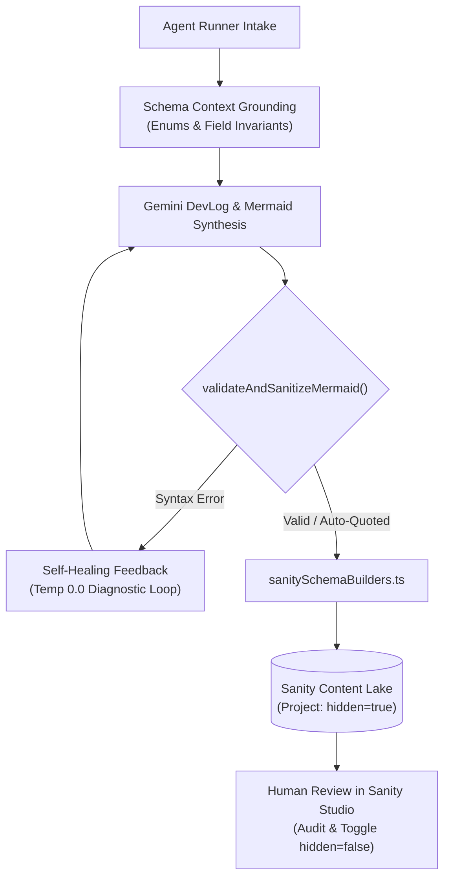

# Sanity Schema Grounding & Stringent Mermaid Validator

**Date Started:** 2026-11-06  
**Status:** Implemented  

## 1. Overview
Eliminates model hallucinations, schema incompleteness, and malformed diagram syntax in the Agentic Writer. Solves the draft-versus-published referential integrity disconnect by publishing projects with `hidden: true` for human review, and enforces strict literal diagram syntax matching `documentation/mermaid_diagram_syntax_guide.md`.

## 2. Architecture & Data Flow

## 3. Core Technical Invariants

### A. The "Hidden from Portfolio" Published-Draft Solution
- **The Invariant:** New Projects created by the Agentic Writer are published directly to the Lake (`project-${config.projectSlug}`) with **`hidden: true`**.
- **Referential Integrity:** Prevents `documentReferenceDoesNotExistError` when `workLog` references `project-${slug}`.
- **Frontend Isolation:** Queries (`allProjectsQuery`, `featuredProjectsQuery`) filter out `hidden == true`, keeping unreviewed projects completely invisible on the live portfolio until manually approved.

### B. Complete Schema Payload Builders (`sanitySchemaBuilders.ts`)
- Populates 100% of required fields: `title`, `slug`, `projectType`, `shortDescription`, `status: 'development'`, `author: 'Agentic Writer'`, `priorityValue: 0`, `featured: false`, `hidden: true`, `website`, `repository`, `techStacks: []`, `collaborators: []`, `media: []`, `content: []`.
- Enforces strict `badge` enum validation (`'Production Release' | 'Architecture' | 'Optimization' | 'Security' | 'Feature' | 'Refactor'`).
- Denormalizes `projectSlug` onto the WorkLog for fail-safe GROQ indexing.

### C. Stringent Mermaid Syntax Validator (`mermaidSyntaxValidator.ts`)
- Enforces literal flowchart (`flowchart TD`, `flowchart LR`) and sequence (`sequenceDiagram`) grammar.
- Auto-wraps node labels in double quotes (e.g. `NodeA["Step Name"]`, `Lake[("Sanity Lake")]`).
- Integrates with Zod `DevLogSynthesisSchema` to feed line-by-line syntax diagnostics back into Gemini's self-healing loop.

### D. UI Null Safety (`ProjectMediaCarousel.tsx`)
- Guards against Sanity GROQ returning `media: null` using `safeMedia = Array.isArray(media) ? media : []`.
- Corrects project title link route from `/blogs/${slug}` to `/blog/${slug}`.

